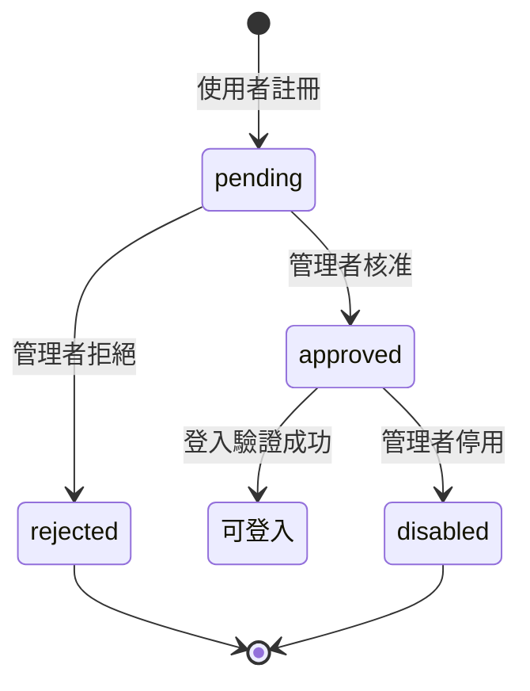
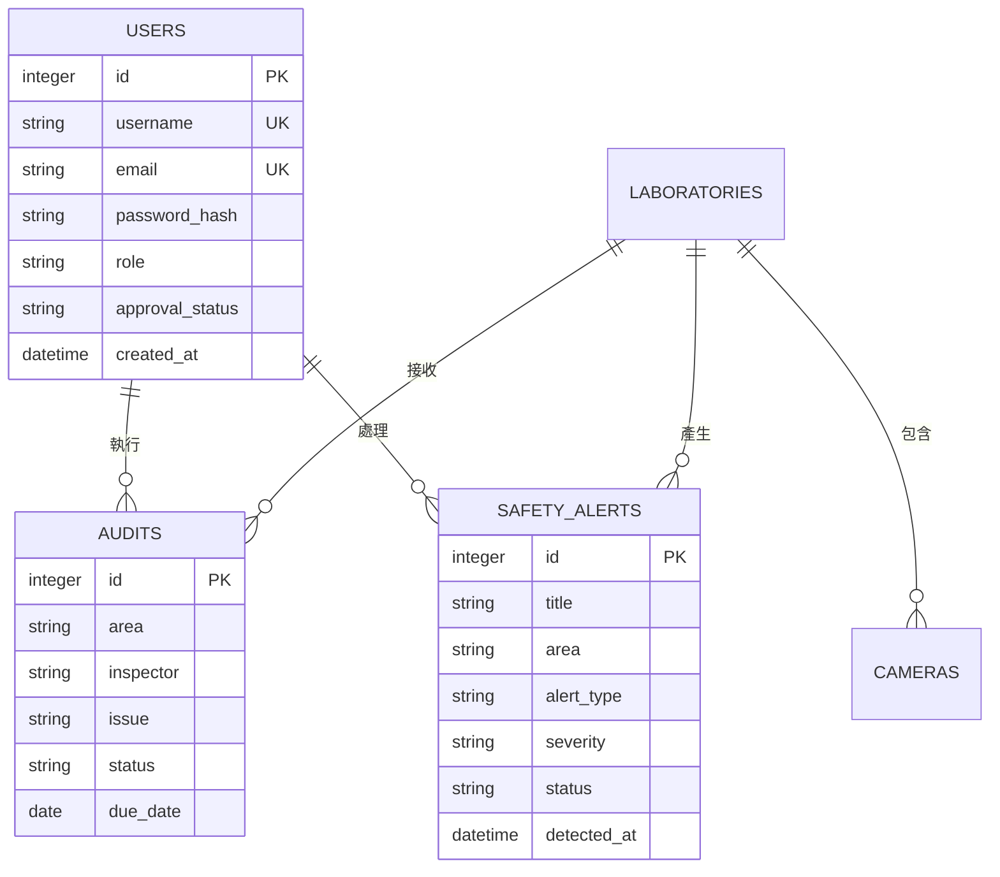

# 實驗室監控系統規格

## 變更目的

將現有系統轉型為「台南大學實驗室監控系統」，提供工安影像監測、事前警示、稽核紀錄與會員審核功能。資料庫固定使用 SQLite，所有文件與介面文字採用繁體中文。

## 使用者角色

### 一般使用者

- 可提出會員註冊申請。
- 註冊申請經管理者核准後才可登入。
- 登入後可查看監控摘要、工安警示與稽核紀錄。

### 管理者

- 可登入管理後台。
- 可核准、拒絕或停用會員。
- 可查看數位儀表板、工安警示與稽核紀錄。
- 可管理實驗室、攝影機與安全處理狀態。

系統預設管理者：

```text
帳號：admin
密碼：admin@123
```

正式環境首次登入後必須修改預設密碼。

## 會員註冊與登入需求

### 註冊

- 註冊表單必須包含帳號、Email、密碼與角色。
- 角色可選擇一般使用者或管理者。
- 新帳號的 `approval_status` 預設為 `pending`。
- 帳號資料必須寫入 SQLite `users` 資料表。
- 密碼只能保存雜湊值，不得保存明文。

### 登入

- 登入時必須驗證帳號、密碼、角色與 `approval_status`。
- `pending` 或 `rejected` 狀態不可登入。
- `approved` 狀態才可建立登入 Session。
- 登入失敗不得回傳密碼或內部資料。

### 會員審核

- 管理者後台提供待審核會員清單。
- 管理者可將會員狀態更新為 `approved`、`rejected` 或 `disabled`。
- 一般使用者不可呼叫會員審核功能。
- 所有會員狀態變更應保存更新時間與操作者。



## 工安監控需求

- 首頁顯示 Logo「台南大學實驗室監控系統」。
- 顯示安全率、即時警示數、待辦稽核數與攝影機連線數。
- 顯示化學實驗室 A、材料實驗室 B、機械加工區與走廊入口等監控區域。
- 第一階段可使用模擬影像卡片與攝影機連線狀態。
- 真實 RTSP、WebRTC 或影像辨識模型整合列入後續變更。

## 工安警示需求

警示資料至少包含：

- `title`：警示標題。
- `area`：發生區域。
- `alert_type`：警示類型。
- `severity`：嚴重程度。
- `status`：處理狀態。
- `detected_at`：偵測時間。
- `description`：警示說明。

第一階段示範警示包括未佩戴護目鏡與煙霧濃度偏高。

## 稽核紀錄需求

稽核資料至少包含區域、稽核人員、問題描述、處理狀態、改善期限與建立時間。管理者或稽核人員可建立、查看與更新稽核紀錄。

## SQLite 資料模型



## API 規格

| 方法 | 路徑 | 說明 |
|---|---|---|
| `POST` | `/api/v1/auth/register` | 建立待審核會員 |
| `POST` | `/api/v1/auth/login` | 驗證帳號與登入狀態 |
| `GET` | `/api/v1/monitoring` | 取得警示、稽核與儀表板統計 |
| `PATCH` | `/api/v1/admin/users/{id}` | 管理者審核會員 |
| `PATCH` | `/api/v1/admin/alerts/{id}` | 更新警示處理狀態 |
| `PATCH` | `/api/v1/admin/audits/{id}` | 更新稽核改善狀態 |

成功回應格式：

```json
{"data": {}}
```

錯誤回應格式：

```json
{"error": {"code": "FORBIDDEN", "message": "需要管理者權限"}}
```

## 前端規範

- Vue 3.0 JavaScript 負責 MVVM 狀態與互動。
- Axios 負責 AJAX 與 API 呼叫。
- Bootstrap 5.3 負責 RWD。
- SweetAlert2 負責確認、成功與錯誤對話盒。
- Tailwind CSS 負責櫥窗玻璃霧面樣式。
- 所有資源必須由本機提供，禁止使用 CDN、遠端字型與遠端 `@import`。

## 驗收條件

1. 使用者可以註冊並選擇角色。
2. 待審核帳號不可登入。
3. `admin` 可以登入並審核會員。
4. 核准會員可以登入監控首頁。
5. 管理者可以查看與更新警示及稽核狀態。
6. SQLite 可以保存會員、審核、警示與稽核資料。
7. 斷開外網後，頁面仍可載入本機 CSS 與 JavaScript。
