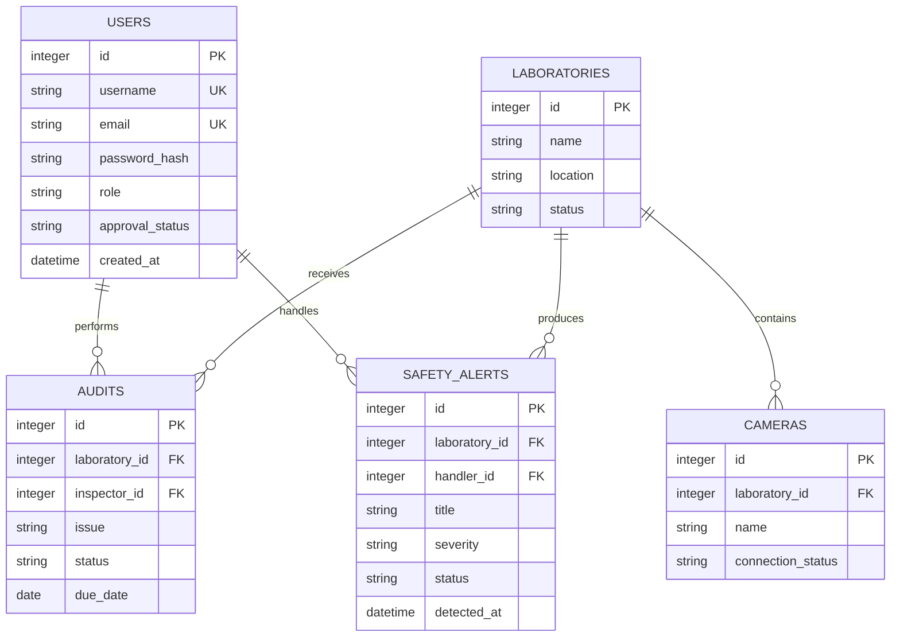
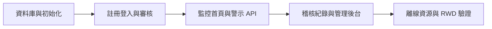

# 實驗室監控系統第一階段實作提案

## 1. 提案摘要

本提案依據 [第一個階段探索.md](第一個階段探索.md) 建立「台南大學實驗室監控系統」第一階段實作範圍，將現有行事曆原型轉型為實驗室工安監控與稽核平台。

第一階段以可操作的安全管理原型為目標，完成會員註冊與審核、登入、角色權限、工安監控摘要、事前警示及稽核紀錄。資料庫固定採用 SQLite，前端採離線架構。

## 2. 目標與成功條件

### 目標

- 建立具品牌識別的工安監控首頁。
- 讓使用者可註冊並選擇角色，經管理者審核後才能使用系統。
- 讓管理者查看會員、警示與稽核資料。
- 以模擬監測資料呈現攝影機狀態與工安警示。
- 建立可延伸至真實影像與感測器的分層架構。

### 成功條件

1. 首頁顯示「台南大學實驗室監控系統」與安全儀表板。
2. 一般使用者與管理者皆可提出註冊申請。
3. 待審核帳號不能登入；核准帳號可依角色使用功能。
4. 管理者可在後台核准或拒絕會員申請。
5. 登入後可查看攝影機區域、警示與稽核紀錄。
6. SQLite 可保存會員、審核、警示與稽核資料。
7. 斷開外網後，頁面仍可使用本機前端資源。

## 3. 第一階段範圍

### 包含

- Flask Application Factory、Blueprint 與分層架構。
- SQLite 初始化、資料表與預設管理者。
- 註冊、登入、登出與 Session。
- 一般使用者／管理者角色。
- 會員待審核、核准、拒絕與停用狀態。
- 工安監控首頁與模擬攝影機卡片。
- 安全警示列表與嚴重程度。
- 稽核紀錄、改善期限與處理狀態。
- 管理者數位儀表板。
- Vue 3、Axios、Bootstrap 5.3、SweetAlert2 與本機 Tailwind 靜態樣式整合。

### 不包含

- 真實攝影機 RTSP／WebRTC 串流整合。
- 真實影像辨識模型部署。
- 真實環境感測器硬體串接。
- Email、簡訊或校務平台通知。
- 生產環境的多因素驗證與單一登入。

## 4. 角色與權限提案

| 角色 | 初始狀態 | 權限 |
|---|---|---|
| 一般使用者 | 待審核 | 核准後查看監控摘要、警示與稽核紀錄 |
| 管理者 | 待審核；系統預設管理者例外初始化 | 審核會員、查看儀表板、管理警示與稽核 |

預設管理者：`admin`／`admin@123`。初始化時建立並視為已核准；正式環境首次登入後必須更換密碼。

## 5. 資料模型提案

## 6. API 與頁面提案

| 類型 | 路徑 | 用途 |
|---|---|---|
| 頁面 | `/` | 工安監控首頁 |
| 頁面 | `/register` | 會員註冊與角色選擇 |
| 頁面 | `/login` | 登入 |
| 頁面 | `/admin` | 管理者儀表板與會員審核 |
| API | `GET /api/v1/monitoring` | 警示、稽核與儀表板統計 |
| API | `POST /api/v1/auth/register` | 建立待審核帳號 |
| API | `POST /api/v1/auth/login` | 驗證帳號與審核狀態 |
| API | `PATCH /api/v1/admin/users/{id}` | 核准、拒絕或停用會員 |
| API | `PATCH /api/v1/admin/alerts/{id}` | 更新警示處理狀態 |
| API | `PATCH /api/v1/admin/audits/{id}` | 更新稽核改善狀態 |

API 成功回應使用 `{ "data": ... }`，錯誤回應使用 `{ "error": { "code": ..., "message": ... } }`。

## 7. 實作分階段

1. **資料層：** 建立 SQLite schema、Repository 與初始化資料。
2. **身分層：** 完成註冊、登入、角色與會員審核 Service/API。
3. **監控層：** 完成監控首頁、警示資料與儀表板統計。
4. **稽核層：** 完成稽核 CRUD、狀態追蹤與管理者操作。
5. **驗證層：** 執行主要使用流程、RWD、瀏覽器錯誤與離線資源檢查。

## 8. 驗收案例

- 新使用者註冊為一般使用者，狀態顯示待審核，登入被拒絕。
- 新使用者註冊為管理者，仍需既有管理者核准。
- `admin` 可以登入後台並核准會員。
- 會員核准後可以登入並查看監控首頁。
- 未登入使用者不可取得監控 API。
- 一般使用者不可呼叫管理者會員審核 API。
- 管理者可更新警示與稽核狀態。
- SQLite 重啟後仍保留會員與稽核資料。
- 停用外網後，CSS 與 JavaScript 仍由本機載入。

## 9. 風險與決策

| 風險 | 影響 | 第一階段決策 |
|---|---|---|
| 真實影像來源尚未確定 | 無法完成串流整合 | 先使用攝影機狀態與模擬畫面 |
| 管理者自我註冊造成權限風險 | 可能產生未授權管理者 | 管理者註冊同樣必須審核 |
| 預設密碼外洩 | 生產環境安全風險 | 初始化後強制更換 |
| 警示規則尚未定義 | 警示準確率不明 | 先建立可配置的警示資料模型 |
| 影像含有個資 | 隱私與法規風險 | 下一階段確認遮罩、保存與存取政策 |

## 10. 提案結論

建議先依本提案完成可驗證的安全監控原型，優先落實「帳號審核」與「警示／稽核追蹤」兩條核心流程，再接入真實攝影機、影像辨識與感測器。此順序可在硬體與模型尚未定案前，先驗證權限、資料流與管理者操作是否符合需求。
