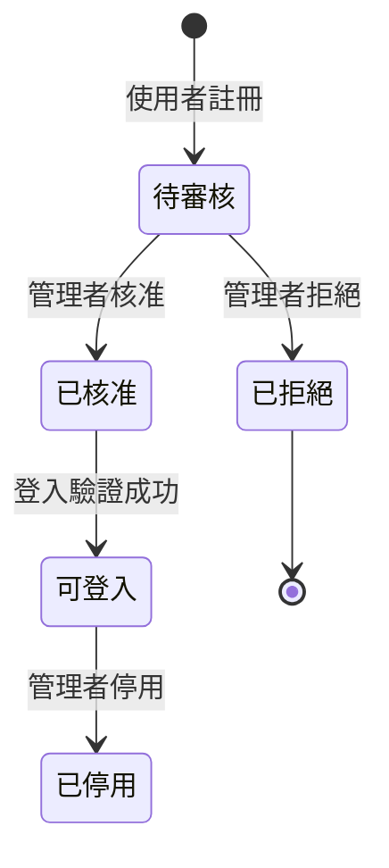
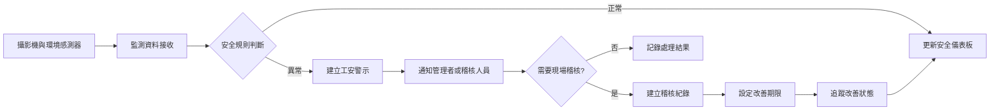
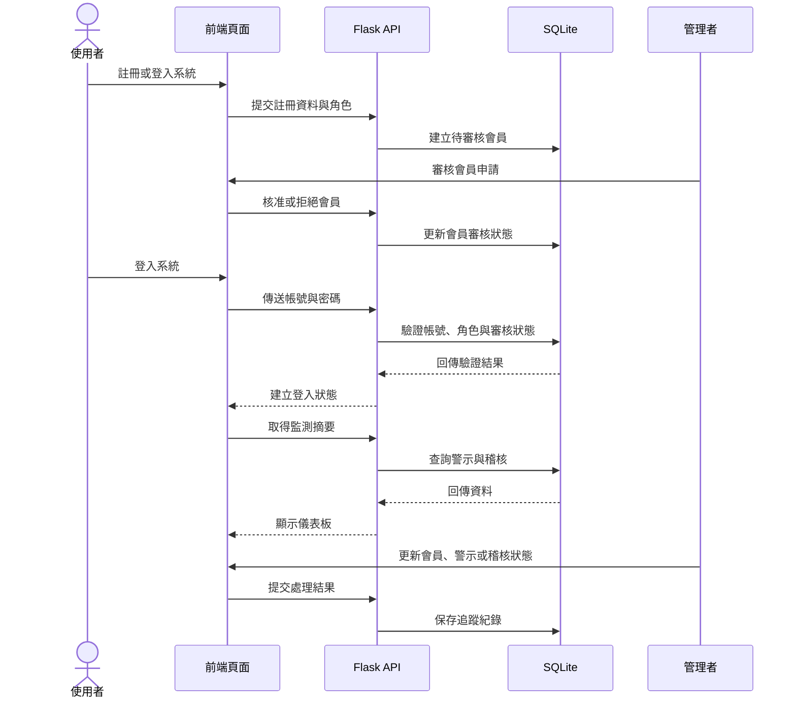
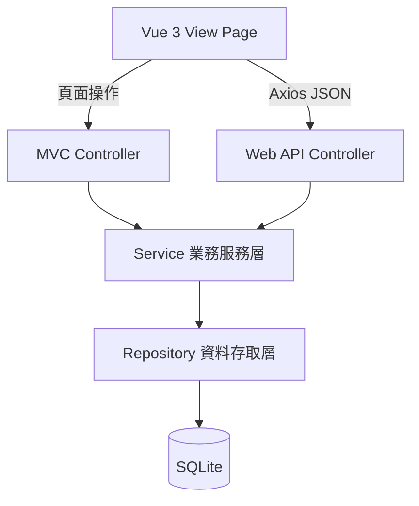
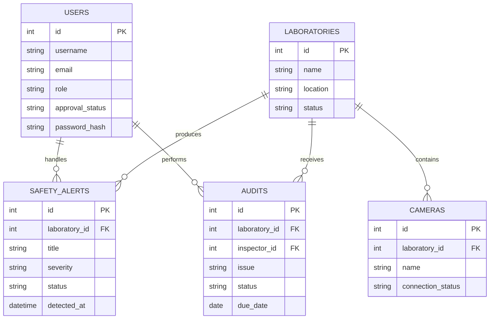
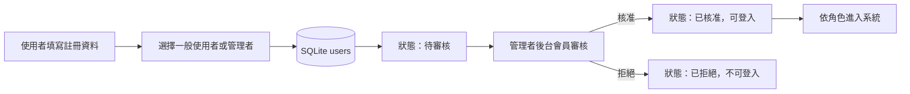

# 台南大學實驗室監控系統
## 第一階段探索報告

**專案目標：** 建立工安影像監測、事前警示與稽核追蹤平台。系統介面、文件與訊息一律使用繁體中文。

## 一、探索結論

本專案由原行事曆系統轉型為實驗室安全管理平台，聚焦「事前預防、即時掌握、事後追蹤」。首頁品牌為「台南大學實驗室監控系統」，以安全率、即時警示、監控攝影機與待辦稽核作為主要指標。

## 二、角色與功能

| 角色 | 功能 |
|---|---|
| 一般使用者 | 註冊後經管理者審核，查看監控摘要、警示與稽核紀錄 |
| 稽核人員 | 建立現場稽核、設定改善期限、更新處理狀態 |
| 管理者 | 審核會員、管理實驗室、攝影機、警示規則與數位儀表板 |

核心功能包括會員註冊、登入、會員審核、工安影像監測、未佩戴防護具警示、煙霧或環境異常警示、稽核紀錄與改善追蹤。預設管理者為 `admin`，密碼為 `admin@123`；正式環境必須立即更換。

### 會員註冊與登入規則

- 註冊時選擇「一般使用者」或「管理者」角色。
- 新註冊帳號一律建立為「待審核」，尚未核准前不可登入或操作系統。
- 管理者可在後台會員管理頁查看申請資料，核准或拒絕註冊。
- 管理者核准後，會員才可登入並依角色使用功能。
- 登入成功後建立安全的 Session；後端每次操作重新檢查角色與審核狀態。

## 三、監測流程

## 四、使用者操作流程

## 五、後端分層

| 層級 | 責任 |
|---|---|
| View Page | 顯示監測狀態、互動與 RWD |
| MVC Controller | 網頁路由、表單與頁面回應 |
| Web API Controller | JSON 請求、狀態碼與錯誤格式 |
| Service | 警示規則、狀態轉移、權限與流程 |
| Repository | SQLite 查詢、寫入、交易與資料映射 |

## 六、資料模型初步規劃

資料庫確認採用 SQLite。會員、警示與稽核資料至少需要 `users`、`safety_alerts`、`audits` 等資料表；`users` 應保存角色與審核狀態。`laboratories`、`cameras`、影像事件與通知紀錄可於下一階段擴充。

## 七、前端與視覺方向

- Vue 3.0 JavaScript：管理監測摘要、警示列表與稽核狀態。
- Axios：呼叫 `/api/v1/monitoring` 與後續監控 API。
- Bootstrap 5.3：負責桌面、平板與手機 RWD。
- SweetAlert2：處理確認、成功與錯誤對話盒。
- Tailwind CSS：實作櫥窗玻璃霧面樣式。
- 所有 CSS、JavaScript、字型與圖示必須本機提供，禁止 CDN。

## 八、第一階段驗收範圍

1. 首頁顯示 Logo、安全率與監控動態圖形。
2. 使用者可以註冊，並選擇一般使用者或管理者角色。
3. 未經管理者核准的帳號不可登入或操作系統。
4. 管理者後台可以核准或拒絕會員申請。
5. 核准後的使用者可以登入、登出並依角色使用功能。
6. 登入後看到攝影機區域與連線狀態。
7. 監控 API 回傳警示、稽核與統計資料。
8. SQLite 可保存會員、審核狀態、警示與稽核紀錄。
9. 無外網時仍可載入本機前端資源。

## 九、下一階段待確認事項

- 真實攝影機串流採 RTSP、WebRTC 或影像上傳。
- 影像辨識模型、環境感測器與警示門檻。
- 系統內通知、Email 或簡訊通知方式。
- 影像保存期限、個資遮罩、存取稽核與權限範圍。
- 稽核附件、照片、簽核與報表匯出需求。

## 十、總結

第一階段已完成系統定位與功能邊界，確認採用 SQLite，並納入註冊、登入、角色選擇、管理者會員審核、監測摘要、警示與稽核資料的原型方向。下一階段可接入真實影像、感測器及通知服務，逐步形成完整的實驗室工安管理平台。

## 十一、本次討論紀錄

### 討論主題

本次討論針對第一階段探索內容補充會員身分與審核流程，確認系統不只提供監控資訊，也必須具備可控的帳號申請與權限授予機制。

### 已確認需求

1. 系統提供註冊功能與登入功能。
2. 註冊時可選擇一般使用者或管理者角色。
3. 新註冊帳號必須先經過管理者審核。
4. 審核通過前，帳號不可登入或使用監控系統。
5. 後台提供會員審核作業，管理者可核准或拒絕申請。
6. 預設管理者帳號為 `admin`。
7. 預設管理者密碼為 `admin@123`。
8. 資料庫確認採用 SQLite。

### 對系統設計的影響

- `users` 資料表必須保存 `role` 與 `approval_status`。
- 登入驗證必須同時確認帳號、密碼、角色與審核狀態。
- 管理者後台需要會員清單、待審核篩選、核准與拒絕操作。
- API 必須對未登入、未審核與無權限狀態回傳不同錯誤結果。
- 預設管理者屬於系統初始化資料；正式部署後應強制修改預設密碼。

### 本次討論後的會員流程

