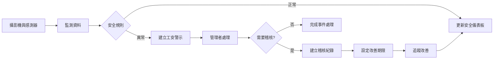
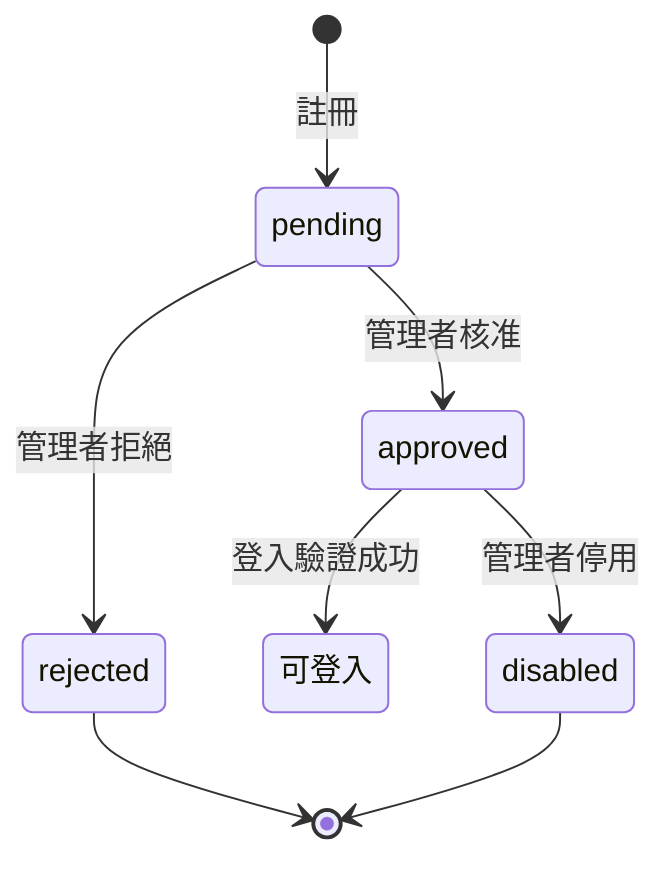
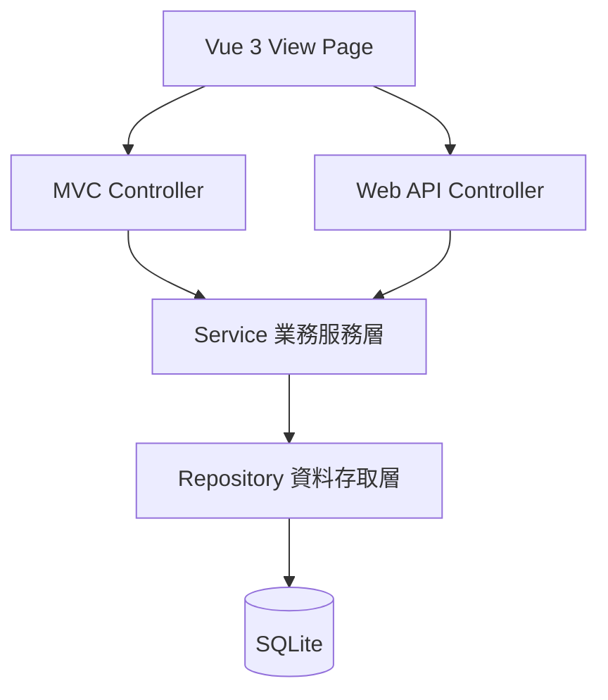
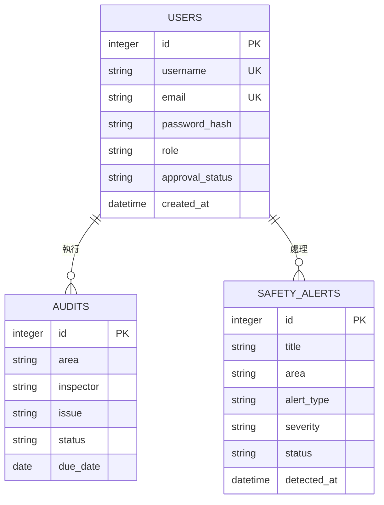
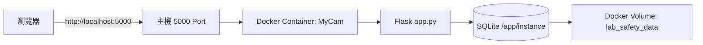

# 台南大學實驗室監控系統
## 第一個階段系統文件

**文件版本：** 1.0  
**容器名稱：** `MyCam`  
**資料庫：** SQLite  
**報告依據：** 本工作區現有實驗室監控原型、`changes/lab-monitoring/spec.md` 與本次部署需求。  
**備註：** 工作區目前未找到 `changes/lab-safety-monitoring-foundation` 目錄，因此本報告以以上可取得的系統規格作為第一階段依據。

## 一、系統定位

本系統將原行事曆原型轉型為「台南大學實驗室監控系統」，提供實驗室工安影像監測、事前警示、稽核紀錄、會員註冊登入與管理者審核。第一階段先以可操作的監控管理原型驗證資料流、權限與管理流程，後續再接入真實攝影機、感測器與影像辨識服務。

## 二、第一階段目標

- 首頁呈現 Logo「台南大學實驗室監控系統」與安全動態圖形。
- 提供一般使用者及管理者註冊申請。
- 新帳號須經管理者審核後才可登入。
- 提供管理者會員審核、警示檢視與稽核追蹤。
- 以 SQLite 持久化會員、警示、稽核及系統原型資料。
- 透過 Docker 建立可重複啟動的部署環境，容器名稱固定為 `MyCam`。

## 三、角色與權限

| 角色 | 權限 |
|---|---|
| 一般使用者 | 註冊申請；核准後查看監控摘要、警示與稽核紀錄 |
| 稽核人員 | 建立稽核紀錄、指定改善期限、更新處理狀態 |
| 管理者 | 會員審核、儀表板、警示處理、稽核管理與資源管理 |

預設管理者為 `admin`，密碼為 `admin@123`。正式部署後應立即更換密碼。

## 四、主要功能

### 4.1 監控首頁

首頁顯示安全率、即時警示、待辦稽核與攝影機連線數，並以玻璃霧面介面呈現化學實驗室 A、材料實驗室 B、機械加工區與走廊入口等監控區域。

### 4.2 工安警示

第一階段示範未佩戴護目鏡、煙霧濃度偏高等異常。每筆警示包含標題、區域、類型、嚴重程度、狀態、偵測時間與說明。

### 4.3 稽核追蹤

稽核紀錄包含區域、稽核人員、問題、改善期限、狀態與建立時間，管理者可追蹤待辦案件。

### 4.4 會員審核

註冊帳號狀態為 `pending`，管理者可更新為 `approved`、`rejected` 或 `disabled`。登入服務必須拒絕非 `approved` 帳號。

## 五、系統流程



## 六、會員審核流程



## 七、後端分層



後端遵循 `Controller → Service → Repository → SQLite`。Controller 不直接查詢資料庫，Service 負責驗證、權限、警示與狀態流程，Repository 負責 SQLite 交易與資料映射。

## 八、資料模型



## 九、前端與離線架構

- Vue 3.0 JavaScript：MVVM 狀態與互動。
- Axios：AJAX 與 `/api/v1/` API 呼叫。
- Bootstrap 5.3：RWD 版面與斷點。
- SweetAlert2：確認、成功與錯誤對話盒。
- Tailwind CSS：櫥窗玻璃霧面視覺。
- 所有資源由本機提供，禁止 CDN、遠端字型與執行時下載。

## 十、Docker 部署設計



部署檔案：

- `Dockerfile`：使用 Python 3.12 slim，安裝 `requirements.txt` 並執行 `app.py`。
- `docker-compose.yml`：建立容器名稱 `MyCam`，映射 `5000:5000`，持久化 SQLite。
- `.dockerignore`：排除快取、虛擬環境、Git 與本機資料庫。

啟動指令：

```powershell
docker compose up -d --build
```

查看狀態：

```powershell
docker ps --filter "name=MyCam"
```

停止服務：

```powershell
docker compose down
```

啟動後網址：<http://localhost:5000>

## 十一、第一階段驗收

1. Docker 可建立並啟動 `MyCam` 容器。
2. 首頁可顯示系統 Logo、安全率與監控區域。
3. 使用者可註冊並選擇角色。
4. 待審核帳號不能登入。
5. 管理者可登入並核准或拒絕會員。
6. 核准會員可查看監控、警示與稽核資料。
7. SQLite 資料在容器重建後透過 Volume 保留。
8. 無外網時可載入本機 CSS 與 JavaScript。

## 十二、風險與後續工作

- 目前攝影機區域為原型卡片，尚未接入真實影像串流。
- 影像辨識與環境感測器門檻尚未定案。
- 需要補充影像保存、個資遮罩、存取稽核與通知政策。
- 預設密碼只適合開發環境，正式環境必須強制更換。
- 若未來使用多程序或多容器，SQLite 寫入併發量需重新評估。

## 十三、結論

第一階段完成實驗室工安監控系統的功能基礎與容器化部署設計。`MyCam` 提供可重複啟動的 Flask 執行環境，SQLite Volume 保存資料，會員審核、工安警示與稽核流程則形成後續接入真實攝影機和感測器的穩定基礎。
