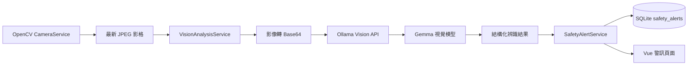
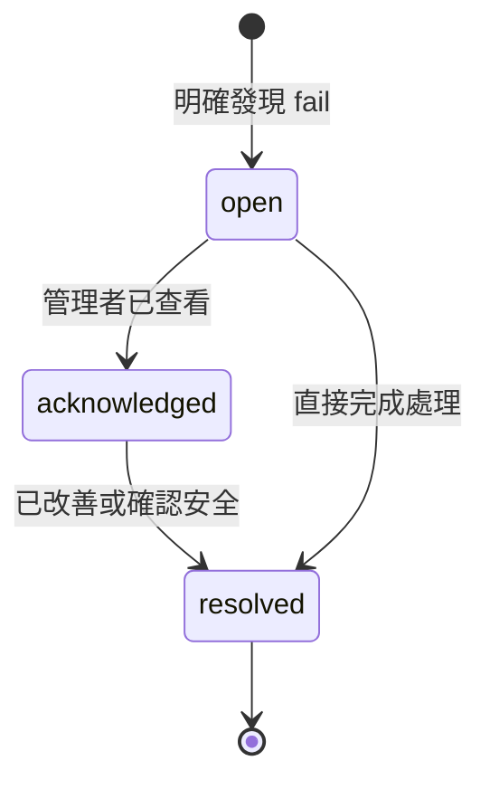

# 第三個階段：建立影像辨識服務探索報告

## 1. 報告目的

本報告整理第三階段「建立影像辨識服務」的需求探索結果，評估如何將 `/video` 的 OpenCV 即時影像交給 Ollama 的 Gemma 視覺模型進行工業安全辨識，並將辨識結果轉換為可追蹤的工安警訊保存至 SQLite。

本階段仍屬需求與架構探索，不代表影像辨識功能已完成，也不應將模型結果視為取代現場安全人員或正式工安稽核。

> 安全提醒：Ollama API 金鑰屬機密，不寫入程式碼、報告、`.env.example` 或 Git。實際部署應使用環境變數，先前在對話中公開的金鑰應撤銷並重新產生。

## 2. 現有系統現況

目前專案已具備以下基礎：

- Flask Application Factory 與 Blueprint。
- `/video` 頁面及 Vue 互動介面。
- `CameraService` 使用 OpenCV `VideoCapture` 開啟主機 CAM。
- 背景執行緒擷取影像、轉成 JPEG，並以 MJPEG 回應提供串流。
- `MonitoringService` 可查詢工安警示，並處理 `open -> resolved`。
- SQLite 已有 `safety_alerts`，並可關聯實驗室及處理人員。
- `opencv-python-headless` 已列入 Python 依賴。

現有 OpenSpec 的 `lab-monitoring` 設計原先排除真實影像辨識，因此本階段應作為新的變更範圍，不能只視為既有 CAM 功能的延伸測試。

## 3. 工業安全檢核範圍與界線

第一版模型只處理以下三項：

| 檢核項目 | 通過條件 | 不符合條件 | 無法判斷 |
|---|---|---|---|
| 安全帽 | 人員有正確佩戴安全帽 | 明確看到人員未戴安全帽 | 人員太小、遮擋或影像模糊 |
| 反光背心 | 人員穿著可辨識的反光背心 | 明確看到人員未穿反光背心 | 背心被遮擋、光線不足或角度不明 |
| 場所圍籬 | 作業場所邊界可看到適當圍籬 | 明確看到邊界未設置圍籬或有缺口 | 影像未涵蓋邊界或無法確認範圍 |

模型輸出應區分 `pass`、`fail` 與 `unknown`。只有明確的 `fail` 才能建立工安警訊；`unknown` 必須記錄為「需人工確認」，不能直接宣稱發生危險。

## 4. 建議系統資料流



建議依賴方向如下：

```text
API Controller
    -> VisionAnalysisService
        -> CameraService
        -> OllamaClient / Repository
        -> SafetyAlertService
            -> SafetyAlertRepository
                -> SQLite
```

Controller 只負責路由、權限、輸入驗證與回應格式；Ollama 呼叫、模型輸出驗證、警訊去重及資料庫交易不得放在 Controller 或 Vue 中。

## 5. Service 設計草案

### 5.1 VisionAnalysisService

責任：

- 取得指定影格或由 Controller 傳入影像資料。
- 限制影像大小、格式與請求頻率。
- 呼叫 Ollama API。
- 要求模型只回傳約定的 JSON 結構。
- 驗證三個檢核項目的狀態與信心分數。
- 對格式錯誤、逾時、連線失敗及模型拒答提供可追蹤但不洩漏機密的錯誤。

不負責：

- 直接操作 Flask `request` 或 `session`。
- 直接寫入 `safety_alerts`。
- 把 `unknown` 自動當成危險。

### 5.2 OllamaClient

建議獨立成外部服務用戶端，設定由環境變數載入：

```text
OLLAMA_BASE_URL
OLLAMA_API_KEY
OLLAMA_MODEL=gemma4:31b-cloud
OLLAMA_TIMEOUT_SECONDS
```

API key 僅在伺服器端使用，不能回傳前端、寫入日志或放在影像辨識結果中。

### 5.3 SafetyAlertService

責任：

- 將辨識結果轉換為警訊決策。
- 只對 `fail` 建立或更新警訊。
- 保存觸發時間、影像辨識摘要、檢核項目、信心分數與模型資訊。
- 避免同一事件在每一影格重複建立警訊。
- 提供管理者確認、處理及結案流程。

### 5.4 Repository

建議提供下列資料存取能力：

- `create_alert(...)`
- `find_open_alert_by_deduplication_key(...)`
- `update_alert_observation(...)`
- `acknowledge_alert(...)`
- `resolve_alert(...)`
- `list_alerts(...)`

所有 SQL 使用參數化查詢；跨辨識結果與警訊寫入時，由 Service 控制交易邊界。

## 6. 建議模型輸出契約

模型不可直接回傳任意自然語言作為唯一結果，應要求結構化 JSON，並由後端再次驗證：

```json
{
  "helmet": {
    "status": "pass",
    "confidence": 0.95,
    "evidence": "可見人員頭部佩戴安全帽"
  },
  "vest": {
    "status": "fail",
    "confidence": 0.88,
    "evidence": "可見人員未穿反光背心"
  },
  "barrier": {
    "status": "unknown",
    "confidence": 0.42,
    "evidence": "影像未涵蓋完整場所邊界"
  },
  "risk_level": "warning",
  "summary": "發現人員未穿反光背心；場所圍籬無法確認"
}
```

後端驗證規則：

- `status` 只能是 `pass`、`fail` 或 `unknown`。
- `confidence` 必須是 0 到 1 的數字。
- 缺少欄位、非法值或非 JSON 回應視為辨識失敗，不建立工安警訊。
- `risk_level` 由後端依規則重新計算或核對，不完全信任模型自行宣告的等級。

## 7. 警訊狀態建議

現有系統使用 `open -> resolved`。若要支援完整處理流程，建議擴充為：



如果本階段希望降低資料庫與前端變更量，也可以先維持 `open -> resolved`，將 `acknowledged` 留給下一階段。這是目前尚未決定的範圍，不應在實作時自行假設。

## 8. 辨識觸發策略

可行方案如下：

| 方案 | 優點 | 風險 | 建議 |
|---|---|---|---|
| 固定間隔自動辨識 | 可持續監控 | API 成本、延遲與重複警訊較高 | 適合正式監控，但需去重與限流 |
| 使用者手動分析 | 成本與行為容易控制 | 無法持續預警 | 適合第一個可驗證原型 |
| 影像變化後辨識 | 可降低重複呼叫 | 仍需設計變化判斷 | 可作為後續最佳化 |

建議先採「手動分析」完成端到端流程，再增加固定間隔自動辨識。若直接進入自動模式，必須先定義間隔、並行鎖、逾時、重試、成本上限及警訊去重規則。

## 9. 安全與可靠性風險

- 模型可能誤判；警訊頁面必須明確標示「AI 輔助辨識」，不可宣稱百分之百正確。
- `unknown` 不應直接轉成危險警報。
- 影像可能包含個人資料，需限制保存原始影像；第一版建議只保存辨識摘要，不保存原始影像。
- Ollama API 連線失敗時不可阻塞鏡頭串流；辨識工作應與影像呈現隔離。
- API key 必須由環境變數或正式秘密管理服務提供。
- 所有外部 API 要設定 timeout，避免背景工作永久卡住。
- 需限制辨識頻率與影像尺寸，避免成本、記憶體及網路流量失控。
- SQLite 單程序寫入需避免多執行緒同時建立相同警訊。

## 10. 驗證範圍

正式實作後至少需要驗證：

1. OpenCV 影格可正常取得，且 `/video` 仍能顯示 MJPEG。
2. Ollama client 可使用環境變數設定，缺少 key 時能清楚失敗。
3. 模型正常 JSON、非法 JSON、逾時與 HTTP 錯誤皆有測試。
4. `pass`、`fail`、`unknown` 三種結果的警訊規則正確。
5. 同一辨識事件不會在每次輪詢重複建立警訊。
6. 警訊可查詢、確認與結案，且保存操作者與時間。
7. API 不會回傳 API key、例外堆疊、內部 URL 或 SQL。
8. 斷開外網時，鏡頭頁面仍可顯示本機狀態；只有 AI 辨識功能進入不可用狀態。

## 11. 待確認決策

進入正式 OpenSpec proposal 前，仍需確認：

1. 第一版採手動辨識，或直接採固定間隔自動辨識？
2. 警訊維持 `open -> resolved`，或擴充 `acknowledged`？
3. 是否保存原始影像？本報告建議不保存，只保存辨識摘要。
4. 警訊的最低信心門檻是多少？例如 `0.7` 是否合適？
5. 圍籬檢核是否需要管理者先定義影像中的邊界區域？
6. Ollama cloud endpoint 的實際 API 格式、認證標頭與模型支援的影像輸入格式，需以目前服務文件或實際測試確認。

## 12. 下一步

需求與狀態模型確認後，使用 `openspec-propose` 建立正式變更，至少包含：

- Ollama Vision Client 與環境設定。
- VisionAnalysisService。
- SafetyAlertService 與 Repository。
- `safety_alerts` schema 變更與 migration。
- 手動辨識 API 與 `/video` 頁面操作。
- 模型輸出驗證、警訊去重及錯誤測試。

本報告只記錄探索結果，不直接實作上述功能。
