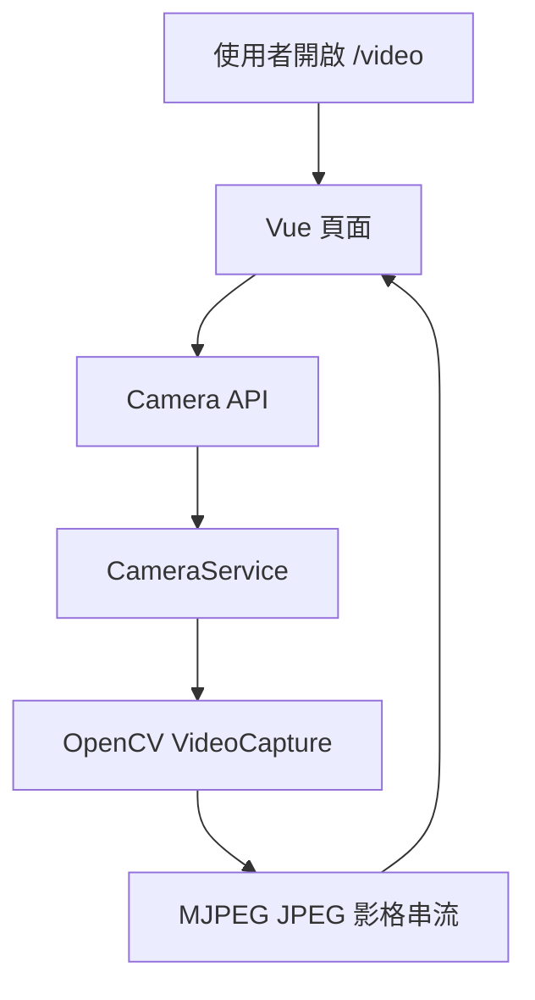
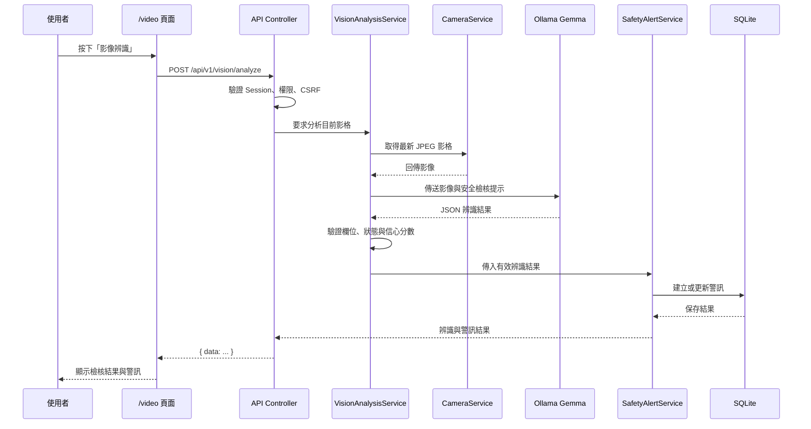
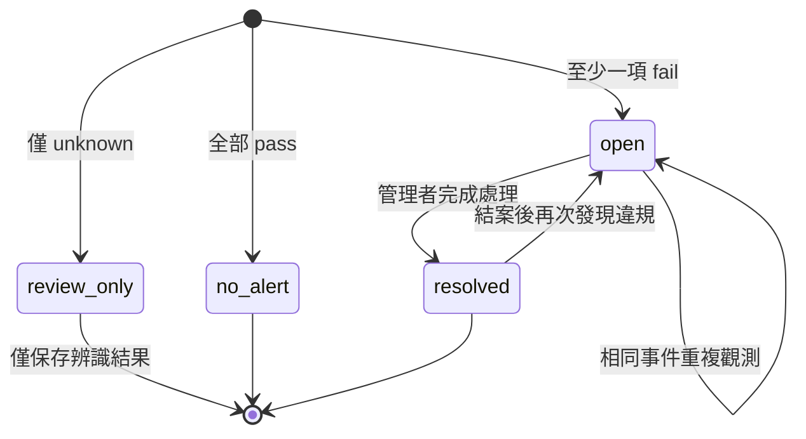
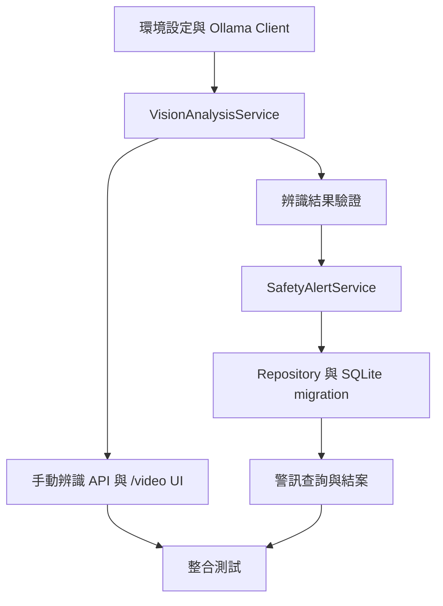

# 第三階段：影像辨識服務系統文件

## 文件說明

本文件整理影像辨識服務的 OpenSpec 提案、規格、設計與實作任務，涵蓋從 `/video` OpenCV 影像取得、Ollama Gemma 視覺辨識，到工安警訊保存與管理的完整流程。

> 來源說明：目前專案中未找到 `changes/add-industrial-safety-image-recognition` 目錄；本文件依現有 `openspec/changes/add-ai-safety-vision-analysis` 的 `proposal.md`、`specs/`、`design.md` 與 `tasks.md` 整理。兩者主題一致，正式變更名稱以目前存在的 `add-ai-safety-vision-analysis` 為準。

> 安全提醒：Ollama API key 僅能透過伺服器環境變數或秘密管理服務提供，不得寫入文件、原始碼、`.env.example`、日志或 Git。先前公開的 key 應撤銷並重新產生。

## 一、系統目標

現有 `/video` 已能使用 OpenCV 開啟主機 CAM、擷取影像並提供 MJPEG 即時串流，但尚未能辨識工業安全風險，也無法將違規結果轉換成可追蹤的工安警訊。

第三階段的目標是建立：

1. Ollama Gemma 視覺模型整合。
2. 安全帽、反光背心、場所邊界圍籬三項工安檢核。
3. 結構化影像辨識結果與信心分數。
4. 工安警訊建立、去重、查詢與結案流程。
5. 與既有 `/video` 串流及 SQLite 架構相容的 Service 分層。

## 二、現有系統基礎



目前已存在的能力：

- Flask Application Factory 與 Blueprint。
- `CameraService` 背景執行緒擷取 CAM 影格。
- OpenCV `VideoCapture` 開啟設備並轉換 JPEG。
- `/api/v1/camera/start`、`/stop`、`/status` 與 `/stream`。
- `MonitoringService` 查詢及處理既有 `safety_alerts`。
- SQLite migration 機制與工安警示資料表。

影像辨識服務不得阻塞或破壞既有 MJPEG 串流；即使 Ollama 服務失敗，使用者仍應能查看本機影像與鏡頭狀態。

## 三、整體架構

```mermaid
flowchart LR
    U[已核准使用者] --> V[/video Vue 頁面]
    V --> C[API Controller]
    C --> S[VisionAnalysisService]
    S --> CAM[CameraService]
    CAM --> CV[OpenCV 最新影格]
    S --> O[Ollama Client]
    O --> G[Gemma 視覺模型]
    G --> R[結構化辨識結果]
    R --> A[SafetyAlertService]
    A --> AR[SafetyAlertRepository]
    AR --> DB[(SQLite safety_alerts)]
    A --> V
```

分層責任：

| 層級 | 責任 |
|---|---|
| Controller | 權限、CSRF、輸入驗證、呼叫 Service、JSON 回應 |
| VisionAnalysisService | 取得影格、呼叫辨識 client、驗證模型輸出 |
| Ollama Client | API 認證、payload、timeout、HTTP 錯誤與回應解析 |
| SafetyAlertService | `fail` 判定、警訊去重、狀態流程與交易協調 |
| Repository | SQLite 參數化查詢、寫入、更新與查詢 |
| Vue View | 啟動辨識、顯示載入、結果、錯誤與警訊狀態 |

## 四、工業安全檢核界線

第一版只檢核以下三項：

| 檢核項目 | `pass` | `fail` | `unknown` |
|---|---|---|---|
| 安全帽 | 人員正確佩戴安全帽 | 明確看到人員未戴安全帽 | 人員太小、遮擋、模糊 |
| 反光背心 | 人員穿著可辨識反光背心 | 明確看到人員未穿反光背心 | 背心遮擋、光線不足 |
| 場所圍籬 | 作業場所邊界可看到適當圍籬 | 明確看到邊界沒有圍籬或有缺口 | 影像未涵蓋完整邊界 |

規則：

- `pass` 表示目前影像符合該項目。
- `fail` 表示模型明確辨識到不符合。
- `unknown` 表示影像不足以做安全判定。
- 只有 `fail` 能建立危險警訊。
- `unknown` 不得直接轉換成危險或違規。

## 五、影像辨識流程



第一版採手動辨識：使用者明確按下辨識按鈕後才呼叫 Ollama，避免每個影格都呼叫 cloud model，降低成本、延遲及重複警訊風險。

## 六、模型輸出契約

模型應回傳可驗證 JSON，後端不可直接信任模型的自然語言結果：

```json
{
  "helmet": {
    "status": "pass",
    "confidence": 0.95,
    "evidence": "可見人員佩戴安全帽"
  },
  "vest": {
    "status": "fail",
    "confidence": 0.88,
    "evidence": "可見人員未穿反光背心"
  },
  "barrier": {
    "status": "unknown",
    "confidence": 0.42,
    "evidence": "影像未涵蓋完整場所邊界"
  },
  "risk_level": "warning",
  "summary": "發現人員未穿反光背心；場所圍籬無法確認"
}
```

後端驗證：

- 狀態只允許 `pass`、`fail`、`unknown`。
- 信心分數必須介於 0 至 1。
- 缺少必要欄位、非法 JSON 或型別錯誤時，辨識視為失敗。
- 無法驗證的模型輸出不得建立工安警訊。
- `risk_level` 不可完全信任，必要時由後端依三項結果重新判定。

## 七、警訊處理與資料流程



警訊規則：

1. 至少一項 `fail`：建立或更新 `open` 警訊。
2. 全部 `pass`：不建立新警訊。
3. 僅有 `unknown`：保存辨識結果，但不建立危險警訊。
4. 同一攝影機、同一檢核項目、既有未結案警訊：更新最近觀測，不重複插入。
5. 既有警訊結案後再次發現違規：建立新的 `open` 警訊。
6. 管理者才能變更警訊狀態。

## 八、資料庫設計方向

現有 `safety_alerts` 應透過可重複執行的 migration 擴充必要欄位，建議涵蓋：

| 欄位群組 | 內容 |
|---|---|
| 來源 | camera_id、laboratory_id、source_type |
| 辨識 | check_type、check_status、confidence、summary、evidence |
| 模型 | provider、model_name、observed_at |
| 狀態 | status、handler_id、resolved_at |
| 去重 | deduplication_key 或等效查詢索引 |

第一版不保存原始影像，只保存必要的辨識摘要、檢核狀態、信心分數、模型資訊與時間。API key、認證標頭及例外堆疊不得進入資料庫。

## 九、錯誤與安全處理

| 情況 | 系統行為 |
|---|---|
| 未登入或未核准 | 拒絕請求，不呼叫 Ollama |
| 無可用影格 | 回傳影像不可用，不建立警訊 |
| API key 未設定 | 辨識端點回傳服務不可用，Flask 仍可啟動 |
| Ollama timeout | 回傳服務不可用，不阻塞 MJPEG |
| Ollama HTTP 失敗 | 統一轉換錯誤，不暴露外部回應敏感內容 |
| 模型回傳非法 JSON | 拒絕辨識結果，不建立警訊 |
| 超過頻率或影像大小限制 | 拒絕請求並回傳限制錯誤 |
| AI 誤判 | 顯示信心分數與 AI 輔助標示，保留人工處理 |

設定必須使用環境變數：

```text
OLLAMA_BASE_URL=
OLLAMA_API_KEY=
OLLAMA_MODEL=gemma4:31b-cloud
OLLAMA_TIMEOUT_SECONDS=
```

## 十、實作任務總覽



### 10.1 外部服務與設定

- 加入 Ollama endpoint、API key、模型、timeout 與影像大小設定。
- 建立外部 API client 邊界。
- 處理成功、timeout、HTTP 錯誤與缺少設定。
- 確認實際 cloud endpoint、認證標頭與 Gemma vision payload 格式。

### 10.2 影像辨識 Service

- 定義影像輸入與三項檢核輸出模型。
- 驗證影像格式、大小與目前影格存在性。
- 驗證 `pass`、`fail`、`unknown` 與信心分數。
- 建立已核准帳號可用的 `/api/v1/` 手動辨識 API。
- 在 `/video` 增加辨識按鈕、載入、成功與失敗狀態。

### 10.3 警訊與資料庫

- 建立可重複執行的 SQLite migration。
- 新增辨識摘要、狀態、信心分數、模型與時間欄位。
- 建立警訊建立、查詢、去重、更新與結案 Repository。
- 建立只對 `fail` 發出警訊的 Service 規則。
- 整合管理者授權與 CSRF。

### 10.4 驗證與文件

- 測試 fake camera、fake Ollama、正常 JSON、非法 JSON、timeout 與授權失敗。
- 驗證重複辨識不產生重複 open 警訊。
- 驗證 `/video` 在 AI 服務不可用時仍可顯示影像。
- 更新 README、環境設定與離線行為說明。
- 執行端到端本機測試並記錄實體 CAM 與外部服務尚未驗證的項目。

## 十一、驗收標準

完成第三階段時，至少應符合：

- 已核准使用者可以從 `/video` 手動要求目前影格辨識。
- 系統能回傳三項工安檢核結果及信心分數。
- `unknown` 不會被錯誤建立為危險警訊。
- 明確 `fail` 能建立或更新對應的 `open` 警訊。
- 重複辨識不會無限制建立相同警訊。
- 管理者可以查詢並完成警訊處理。
- Ollama 失敗不會中斷本機 MJPEG 串流。
- API key、SQL、例外堆疊與內部敏感資訊不會洩漏。
- SQLite migration 可重複執行，既有警訊資料仍可讀取。

## 十二、尚待確認事項

1. Ollama cloud endpoint、認證標頭與 Gemma vision payload 的正式格式。
2. 三項檢核的最低信心門檻。
3. 圍籬判定是否需要管理者設定影像邊界區域。
4. 是否在後續階段加入 `acknowledged` 警訊狀態。
5. 是否由手動辨識擴充為固定間隔或影像變化觸發。

## 十三、結論

本階段應以「手動觸發、結構化輸出、明確 fail 才告警、外部服務與鏡頭串流隔離」作為第一版核心原則。如此可在保留現有 `/video` 功能的同時，逐步導入 AI 工安辨識，並降低模型誤判、成本失控、資料重複及 API key 洩漏風險。
