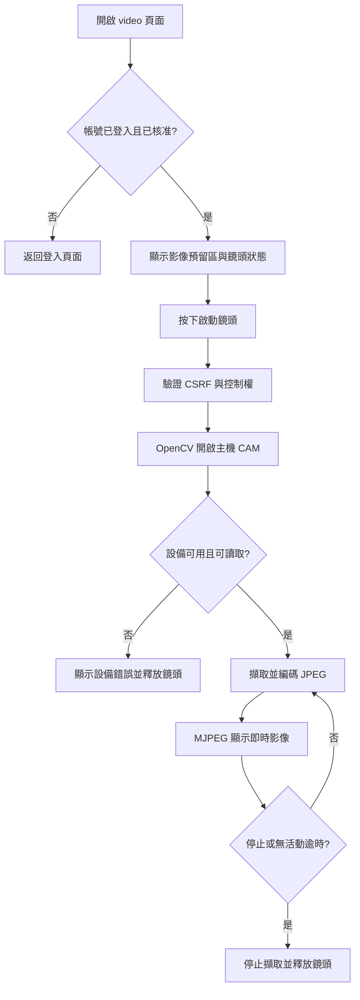
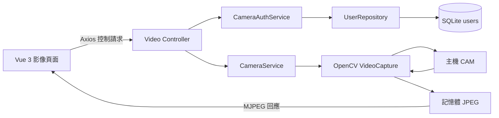
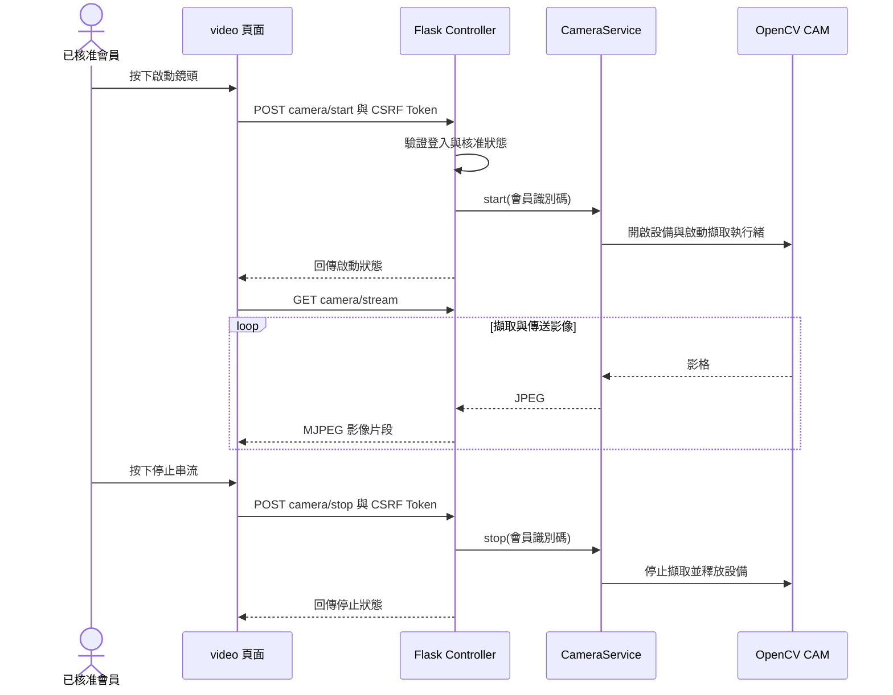
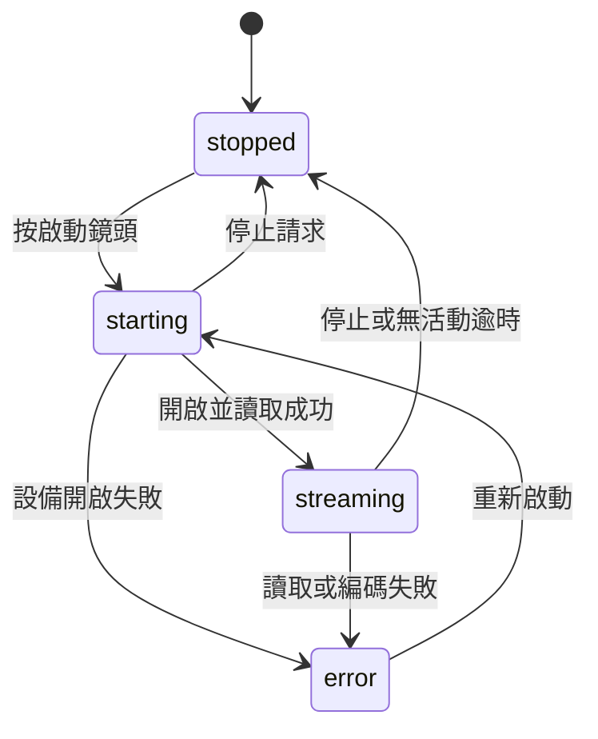

# 台南大學實驗室監控系統

## 第二階段探索報告：CAM 串接

| 項目 | 說明 |
|---|---|
| 文件日期 | 2026-10-06 |
| 階段 | 第二階段：OpenCV 鏡頭串接 |
| 頁面入口 | `/video` |
| 技術 | Python、Flask、OpenCV、MJPEG |
| 探索依據 | 本次 CAM 串接討論、現有程式與功能測試 |

## 一、背景與目標

第一階段建立實驗室監控首頁、會員註冊登入、會員審核及工安資料的基礎。第二階段將監控影像從示意區域延伸為實際 CAM 擷取，讓已核准會員在頁面中手動啟動與停止鏡頭，並掌握設備與串流狀態。

本階段確認需求如下：

1. 提供 `/video` 影像監控頁面。
2. 使用 OpenCV 開啟 CAM。
3. 必須按下按鈕才開啟設備與顯示即時影像。
4. 提供停止串流按鈕與鏡頭資源釋放機制。
5. 顯示鏡頭編號、影格數、串流狀態與錯誤說明。

## 二、功能範圍與操作方式

### 已納入範圍

- 已核准會員登入後存取 `/video`。
- 「啟動鏡頭」按鈕觸發主機 CAM 擷取。
- 以 MJPEG 在頁面影像區域顯示即時畫面。
- 「停止串流」按鈕停止擷取並釋放設備。
- 每 2 秒更新鏡頭狀態與已擷取影格數。
- 單一主機鏡頭由一位使用者控制，避免不同會員互相停止設備。
- 離開頁面時發送停止請求；無活動超過 20 秒時自動停止。

### 操作步驟

1. 執行 `start.ps1` 啟動 Flask。
2. 使用已核准帳號登入。
3. 點選首頁「鏡頭串流」，或直接開啟 `/video`。
4. 按下「啟動鏡頭」，等待狀態轉為串流中。
5. 檢視影像與影格計數。
6. 按下「停止串流」，確認鏡頭已停止並釋放。

> CAM 指 Flask 伺服器主機所連接的攝影機，不是遠端使用者瀏覽器所在電腦的鏡頭。預設設備編號為 `0`，可透過 `CAMERA_INDEX` 環境變數調整。

### 本階段未涵蓋

音訊、錄影保存、影像辨識、工安事件自動生成、多鏡頭切換、RTSP／WebRTC、串流歷程保存與多程序鏡頭服務尚未納入本階段。

## 三、操作流程圖



## 四、分層與資料流

本功能依工作區 `AGENTS.md` 與 `python-flask-skills` 實作。Controller 處理路由、身分與 CSRF 檢查、HTTP 回應；Service 管理設備生命週期與擷取。會員核准狀態經由身分 Service 與 Repository 查詢 SQLite。



| 元件 | 檔案 | 責任 |
|---|---|---|
| 頁面 | `app/templates/video.html` | 影像區域、按鈕與狀態介面 |
| 前端互動 | `app/static/js/video.js` | Axios 操作、Vue 狀態更新、SweetAlert2 提示 |
| Controller | `app/controllers/video.py` | 頁面路由、API、登入核准檢查與 CSRF |
| 身分 Service | `app/services/camera_auth_service.py` | 查驗會員核准狀態 |
| 鏡頭 Service | `app/services/camera_service.py` | 開啟、擷取、編碼、控制權、停止與釋放 |
| Repository | `app/repositories/user_repository.py` | 取得會員資料 |
| 測試 | `tests/test_video.py` | 身分、CSRF、串流與設備生命週期測試 |

## 五、啟動與停止時序



## 六、鏡頭狀態與生命週期



| 狀態代碼 | 中文意義 | 頁面行為 |
|---|---|---|
| `stopped` | 尚未啟動或已停止 | 顯示影像預留區，可啟動 |
| `starting` | 正在開啟鏡頭 | 等待設備與第一個影格，避免重複啟動 |
| `streaming` | 即時串流中 | 顯示 JPEG 串流與擷取影格數 |
| `error` | 設備或影像處理錯誤 | 顯示原因，可再次啟動 |

`CameraService` 在背景執行緒擷取影像，使用鎖與條件通知協調狀態。停止會發出停止訊號，等待執行緒最多 3 秒；如果硬體讀取阻塞，實際釋放仍須等待擷取作業返回。狀態應以後續查詢結果為準。

## 七、API 與資料契約

| 方法 | 路徑 | 功能 |
|---|---|---|
| GET | `/video` | 已核准會員的鏡頭頁面 |
| GET | `/api/v1/camera/status` | 查詢設備與串流狀態，不開啟鏡頭 |
| POST | `/api/v1/camera/start` | 手動啟動設備與擷取 |
| POST | `/api/v1/camera/stop` | 停止擷取與釋放 |
| GET | `/api/v1/camera/stream` | 已啟動鏡頭的 MJPEG 回應 |

控制與狀態 API 成功時使用 `data` 包裝；串流端點回傳 `multipart/x-mixed-replace; boundary=frame`，不是 JSON。未啟動就要求串流時回傳 409。

```json
{
  "data": {
    "state": "streaming",
    "message": "鏡頭已連接，影像串流中",
    "camera_index": 0,
    "frames": 120,
    "can_control": true
  }
}
```

| 欄位 | 說明 |
|---|---|
| `state` | 鏡頭生命週期狀態 |
| `message` | 繁體中文操作或錯誤訊息 |
| `camera_index` | OpenCV 設備編號 |
| `frames` | 本次啟動後已擷取的影格總數，不代表 FPS |
| `can_control` | 目前會員是否可控制設備 |

主要錯誤包括：401 未登入或帳號未核准、403 CSRF 失敗或無停止權限、409 鏡頭被占用或尚未啟動。設備擷取失敗以狀態 API 的 `error` 與 `message` 顯示。

## 八、資料庫與離線資源

本階段沿用 SQLite `users` 查驗帳號，不新增攝影機資料表。鏡頭狀態、控制者與最新 JPEG 保存於主機記憶體，不寫入 SQLite，不保存錄影；程序重啟後狀態重設。

前端採本機 Vue 3、Axios、Bootstrap 5.3、SweetAlert2，並使用編譯完成的 Tailwind CSS，執行時不需 CDN。套件版本與授權記錄於 `app/static/vendor/VERSIONS.md`，Tailwind 建置設定與 lock file 位於 `frontend`。

## 九、部署條件與限制

- 預設使用主機鏡頭 `0`；Windows 使用 DirectShow 開啟 CAM。
- 必須安裝 `requirements.txt` 內的 OpenCV 依賴。
- 目前鏡頭狀態由單一程序管理，不適用多 WSGI worker 共用同一設備。
- Docker 不會自動取得主機攝影機，需另行設定裝置傳入。Windows Docker Desktop 的 Linux 容器不可直接假設能存取 Windows USB CAM。
- 單一使用者的不同頁籤共用相同控制身分，因此其中一頁停止可能影響另一頁。
- 離頁停止請求可能受瀏覽器或網路影響；無活動逾時提供補充清理機制。

## 十、驗證結果

| 驗證項目 | 結果與證據 |
|---|---|
| 未登入存取狀態 API | 測試確認回傳 401 |
| 控制請求缺少 CSRF | 測試確認回傳 403 |
| 未啟動時要求串流 | 測試確認回傳 409 |
| 未按按鈕不開鏡頭 | 模擬設備測試確認狀態查詢不觸發開啟 |
| 即時影像格式 | 模擬設備測試確認 MJPEG 片段包含 JPEG |
| 停止與釋放 | 模擬設備測試確認停止狀態與 release 呼叫 |
| 設備不可用 | 模擬設備測試確認轉為 error |
| 實體 CAM | 先前實機測試成功擷取影格，停止後釋放設備 |
| JavaScript 與樣式 | JavaScript 語法檢查與 Tailwind 編譯通過 |
| 瀏覽器與 RWD | 目前無可連接瀏覽器，尚未完成視覺與按鈕互動驗證 |

本次重跑 `tests/test_video.py` 的 3 項測試均通過。以上結果不能替代瀏覽器、長時間串流、Docker 裝置傳入及多使用者操作驗證。

## 十一、後續探索與驗收

下一階段可依需求確認多鏡頭選擇、區域與設備對應、影像辨識、事件紀錄、影格率及影像尺寸設定。建議先補完瀏覽器驗收：啟動後可見即時影像、停止後設備釋放、拔除鏡頭後顯示錯誤、重新接上可恢復，以及手機版操作不溢出。

本階段已形成從按鈕觸發、OpenCV 擷取、MJPEG 呈現到停止釋放的核心流程，可作為後續工安影像辨識整合的基礎。
