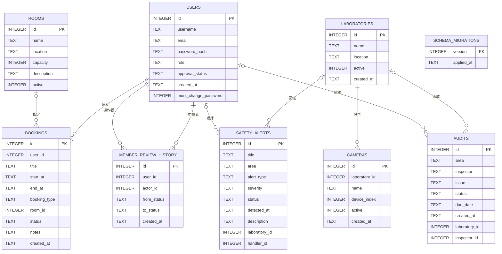
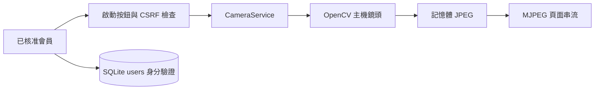

# 台南大學實驗室監控系統：資料結構文件

文件日期：2026-10-06。來源：實際 SQLite schema 與 app/repositories/database.py；本報告不列出會員密碼雜湊或個人資料。


## 一、資料庫建立與儲存

資料庫採 SQLite。Application Factory 啟動時呼叫 init_db，自動建立不存在的資料表，並為舊 users 表補上 approval_status。實際檔案為 instance/calendar.sqlite；名稱沿用舊系統，不代表資料庫僅供行事曆使用。既有資料保留，不重建或清空。

僅首次建立資料庫時初始化管理者與示範資料。admin 預設密碼為 admin@123、狀態 approved、must_change_password=1。重啟不覆寫密碼、不補回被清空的示範事件。schema_migrations 追蹤版本 1 至 3。


## 二、資料表總覽

| 資料表 | 用途 | 欄位數 |
|---|---|---|
| users | 會員帳號 | 8 |
| rooms | 會議廳資源（舊系統保留） | 6 |
| bookings | 行事曆預約（舊系統保留） | 10 |
| safety_alerts | 工安警示 | 10 |
| audits | 稽核紀錄 | 9 |
| member_review_history | 會員審核歷程 | 6 |
| laboratories | 實驗室資源 | 5 |
| cameras | 攝影機資源 | 6 |
| schema_migrations | 資料庫升級版本 | 2 |

## 三、資料關聯圖



實體關聯包含會員／預約、會員／審核歷程、實驗室／攝影機。警示與稽核新增可空的實驗室及會員外鍵，保留 area、inspector 文字快照，既有資料不猜測關聯。下圖為原資料表概覽；完整關聯見本節對照。

| 關聯來源 | 目標 | 用途 |
|---|---|---|
| users.id | member_review_history.user_id / actor_id | 會員與操作者 |
| laboratories.id | cameras.laboratory_id | 必要設備歸屬 |
| laboratories.id | safety_alerts / audits.laboratory_id | 可空區域歸屬 |
| users.id | safety_alerts.handler_id / audits.inspector_id | 可空執行人員 |

## 四、會員帳號：users

| 欄位 | 型別 | 空值／鍵 | 預設值 | 資料辭典 |
|---|---|---|---|---|
| id | INTEGER | 主鍵 | 無 | 資料唯一識別碼；整數自動遞增主鍵 |
| username | TEXT | 不可空 | 無 | 登入帳號，不可重複 |
| email | TEXT | 不可空 | 無 | 會員電子郵件，不可重複 |
| password_hash | TEXT | 不可空 | 無 | 密碼雜湊值；不可輸出至 API 或報表 |
| role | TEXT | 不可空 | 'user' | 角色：user 一般使用者、admin 管理者 |
| approval_status | TEXT | 不可空 | 'pending' | 會員審核：pending 待審核、approved 核准、rejected 拒絕、disabled 停用 |
| created_at | TEXT | 可空 | CURRENT_TIMESTAMP | 建立時間；SQLite CURRENT_TIMESTAMP 為 UTC |
| must_change_password | INTEGER | 不可空 | 0 | 1 表示需先變更預設密碼，0 表示不需變更 |
索引：idx_users_approval（一般）；sqlite_autoindex_users_2（唯一）；sqlite_autoindex_users_1（唯一）


### 建表 SQL（實際資料庫）
```sql
CREATE TABLE users (id INTEGER PRIMARY KEY AUTOINCREMENT, username TEXT UNIQUE NOT NULL, email TEXT UNIQUE NOT NULL, password_hash TEXT NOT NULL, role TEXT NOT NULL DEFAULT 'user', approval_status TEXT NOT NULL DEFAULT 'pending', created_at TEXT DEFAULT CURRENT_TIMESTAMP, must_change_password INTEGER NOT NULL DEFAULT 0 CHECK(must_change_password IN (0,1)));
```


## 四、會議廳資源（舊系統保留）：rooms

| 欄位 | 型別 | 空值／鍵 | 預設值 | 資料辭典 |
|---|---|---|---|---|
| id | INTEGER | 主鍵 | 無 | 資料唯一識別碼；整數自動遞增主鍵 |
| name | TEXT | 不可空 | 無 | 資源名稱，不可重複 |
| location | TEXT | 不可空 | 無 | 所在位置 |
| capacity | INTEGER | 不可空 | 無 | 可容納人數 |
| description | TEXT | 可空 | '' | 補充說明 |
| active | INTEGER | 不可空 | 1 | 啟用旗標：1 啟用、0 停用 |
索引：sqlite_autoindex_rooms_1（唯一）


### 建表 SQL（實際資料庫）
```sql
CREATE TABLE rooms (id INTEGER PRIMARY KEY AUTOINCREMENT, name TEXT UNIQUE NOT NULL, location TEXT NOT NULL, capacity INTEGER NOT NULL, description TEXT DEFAULT '', active INTEGER NOT NULL DEFAULT 1);
```


## 四、行事曆預約（舊系統保留）：bookings

| 欄位 | 型別 | 空值／鍵 | 預設值 | 資料辭典 |
|---|---|---|---|---|
| id | INTEGER | 主鍵 | 無 | 資料唯一識別碼；整數自動遞增主鍵 |
| user_id | INTEGER | 不可空 | 無 | 預約會員，參照 users.id |
| title | TEXT | 不可空 | 無 | 事件或警示標題 |
| start_at | TEXT | 不可空 | 無 | 預約開始時間；目前以 TEXT 保存 |
| end_at | TEXT | 不可空 | 無 | 預約結束時間；目前以 TEXT 保存 |
| booking_type | TEXT | 不可空 | 'personal' | 預約類型：personal 個人、room 會議廳 |
| room_id | INTEGER | 可空 | 無 | 會議廳識別碼；個人預約可為 NULL |
| status | TEXT | 不可空 | 'confirmed' | 預約狀態：confirmed、pending、approved、rejected |
| notes | TEXT | 可空 | '' | 預約備註 |
| created_at | TEXT | 可空 | CURRENT_TIMESTAMP | 建立時間；SQLite CURRENT_TIMESTAMP 為 UTC |
索引：無額外索引；整數主鍵使用 SQLite rowid。


### 建表 SQL（實際資料庫）
```sql
CREATE TABLE bookings (id INTEGER PRIMARY KEY AUTOINCREMENT, user_id INTEGER NOT NULL, title TEXT NOT NULL, start_at TEXT NOT NULL, end_at TEXT NOT NULL, booking_type TEXT NOT NULL DEFAULT 'personal', room_id INTEGER, status TEXT NOT NULL DEFAULT 'confirmed', notes TEXT DEFAULT '', created_at TEXT DEFAULT CURRENT_TIMESTAMP, FOREIGN KEY(user_id) REFERENCES users(id), FOREIGN KEY(room_id) REFERENCES rooms(id));
```


## 四、工安警示：safety_alerts

| 欄位 | 型別 | 空值／鍵 | 預設值 | 資料辭典 |
|---|---|---|---|---|
| id | INTEGER | 主鍵 | 無 | 資料唯一識別碼；整數自動遞增主鍵 |
| title | TEXT | 不可空 | 無 | 事件或警示標題 |
| area | TEXT | 不可空 | 無 | 實驗室或區域名稱，目前為文字而非外鍵 |
| alert_type | TEXT | 不可空 | 無 | 警示類型，例如個人防護、環境異常 |
| severity | TEXT | 不可空 | 'medium' | 嚴重程度，預設 medium；示範資料另有 high |
| status | TEXT | 不可空 | 'open' | 警示處理狀態，預設 open；目前未以 CHECK 限制 |
| detected_at | TEXT | 可空 | CURRENT_TIMESTAMP | 偵測時間；預設 UTC CURRENT_TIMESTAMP |
| description | TEXT | 可空 | '' | 補充說明 |
| laboratory_id | INTEGER | 可空 | 無 | 實驗室外鍵，參照 laboratories.id |
| handler_id | INTEGER | 可空 | 無 | 警示處理者，可空；參照 users.id |
索引：idx_alerts_status（一般）


### 建表 SQL（實際資料庫）
```sql
CREATE TABLE safety_alerts (id INTEGER PRIMARY KEY AUTOINCREMENT, title TEXT NOT NULL, area TEXT NOT NULL, alert_type TEXT NOT NULL, severity TEXT NOT NULL DEFAULT 'medium', status TEXT NOT NULL DEFAULT 'open', detected_at TEXT DEFAULT CURRENT_TIMESTAMP, description TEXT DEFAULT '', laboratory_id INTEGER REFERENCES laboratories(id), handler_id INTEGER REFERENCES users(id));
```


## 四、稽核紀錄：audits

| 欄位 | 型別 | 空值／鍵 | 預設值 | 資料辭典 |
|---|---|---|---|---|
| id | INTEGER | 主鍵 | 無 | 資料唯一識別碼；整數自動遞增主鍵 |
| area | TEXT | 不可空 | 無 | 實驗室或區域名稱，目前為文字而非外鍵 |
| inspector | TEXT | 不可空 | 無 | 稽核人員名稱，目前為文字而非會員外鍵 |
| issue | TEXT | 不可空 | 無 | 稽核問題描述 |
| status | TEXT | 不可空 | 'open' | 改善處理狀態，預設 open；目前未以 CHECK 限制 |
| due_date | TEXT | 可空 | 無 | 改善期限，建議 YYYY-MM-DD；目前無格式約束 |
| created_at | TEXT | 可空 | CURRENT_TIMESTAMP | 建立時間；SQLite CURRENT_TIMESTAMP 為 UTC |
| laboratory_id | INTEGER | 可空 | 無 | 實驗室外鍵，參照 laboratories.id |
| inspector_id | INTEGER | 可空 | 無 | 稽核執行者會員 ID，可空；參照 users.id |
索引：idx_audits_status（一般）


### 建表 SQL（實際資料庫）
```sql
CREATE TABLE audits (id INTEGER PRIMARY KEY AUTOINCREMENT, area TEXT NOT NULL, inspector TEXT NOT NULL, issue TEXT NOT NULL, status TEXT NOT NULL DEFAULT 'open', due_date TEXT, created_at TEXT DEFAULT CURRENT_TIMESTAMP, laboratory_id INTEGER REFERENCES laboratories(id), inspector_id INTEGER REFERENCES users(id));
```


## 四、會員審核歷程：member_review_history

| 欄位 | 型別 | 空值／鍵 | 預設值 | 資料辭典 |
|---|---|---|---|---|
| id | INTEGER | 主鍵 | 無 | 資料唯一識別碼；整數自動遞增主鍵 |
| user_id | INTEGER | 不可空 | 無 | 被審核會員，參照 users.id |
| actor_id | INTEGER | 不可空 | 無 | 審核操作者，參照 users.id |
| from_status | TEXT | 不可空 | 無 | 審核前狀態 |
| to_status | TEXT | 不可空 | 無 | 審核後狀態：approved、rejected、disabled |
| created_at | TEXT | 不可空 | CURRENT_TIMESTAMP | 建立時間；SQLite CURRENT_TIMESTAMP 為 UTC |
索引：idx_review_user（一般）


### 建表 SQL（實際資料庫）
```sql
CREATE TABLE member_review_history (id INTEGER PRIMARY KEY AUTOINCREMENT,user_id INTEGER NOT NULL REFERENCES users(id),actor_id INTEGER NOT NULL REFERENCES users(id),from_status TEXT NOT NULL,to_status TEXT NOT NULL CHECK(to_status IN ('approved','rejected','disabled')),created_at TEXT NOT NULL DEFAULT CURRENT_TIMESTAMP);
```


## 四、實驗室資源：laboratories

| 欄位 | 型別 | 空值／鍵 | 預設值 | 資料辭典 |
|---|---|---|---|---|
| id | INTEGER | 主鍵 | 無 | 資料唯一識別碼；整數自動遞增主鍵 |
| name | TEXT | 不可空 | 無 | 資源名稱，不可重複 |
| location | TEXT | 不可空 | 無 | 所在位置 |
| active | INTEGER | 不可空 | 1 | 啟用旗標：1 啟用、0 停用 |
| created_at | TEXT | 不可空 | CURRENT_TIMESTAMP | 建立時間；SQLite CURRENT_TIMESTAMP 為 UTC |
索引：sqlite_autoindex_laboratories_1（唯一）


### 建表 SQL（實際資料庫）
```sql
CREATE TABLE laboratories (id INTEGER PRIMARY KEY AUTOINCREMENT,name TEXT NOT NULL UNIQUE,location TEXT NOT NULL,active INTEGER NOT NULL DEFAULT 1 CHECK(active IN (0,1)),created_at TEXT NOT NULL DEFAULT CURRENT_TIMESTAMP);
```


## 四、攝影機資源：cameras

| 欄位 | 型別 | 空值／鍵 | 預設值 | 資料辭典 |
|---|---|---|---|---|
| id | INTEGER | 主鍵 | 無 | 資料唯一識別碼；整數自動遞增主鍵 |
| laboratory_id | INTEGER | 不可空 | 無 | 實驗室外鍵，參照 laboratories.id |
| name | TEXT | 不可空 | 無 | 攝影機顯示名稱，不要求全域唯一 |
| device_index | INTEGER | 不可空 | 0 | 設備索引，非負整數；不代表實際鏡頭已連接 |
| active | INTEGER | 不可空 | 1 | 啟用旗標：1 啟用、0 停用 |
| created_at | TEXT | 不可空 | CURRENT_TIMESTAMP | 建立時間；SQLite CURRENT_TIMESTAMP 為 UTC |
索引：idx_cameras_lab（一般）


### 建表 SQL（實際資料庫）
```sql
CREATE TABLE cameras (id INTEGER PRIMARY KEY AUTOINCREMENT,laboratory_id INTEGER NOT NULL REFERENCES laboratories(id),name TEXT NOT NULL,device_index INTEGER NOT NULL DEFAULT 0 CHECK(device_index>=0),active INTEGER NOT NULL DEFAULT 1 CHECK(active IN (0,1)),created_at TEXT NOT NULL DEFAULT CURRENT_TIMESTAMP);
```


## 四、資料庫升級版本：schema_migrations

| 欄位 | 型別 | 空值／鍵 | 預設值 | 資料辭典 |
|---|---|---|---|---|
| version | INTEGER | 主鍵 | 無 | 已完成升級版本，整數主鍵 |
| applied_at | TEXT | 不可空 | CURRENT_TIMESTAMP | 版本升級完成時間，UTC |
索引：無額外索引；整數主鍵使用 SQLite rowid。


### 建表 SQL（實際資料庫）
```sql
CREATE TABLE schema_migrations (version INTEGER PRIMARY KEY, applied_at TEXT NOT NULL DEFAULT CURRENT_TIMESTAMP);
```


## 五、約束、日期與完整性

SQLite 採動態型別，TEXT 日期不是專用日期型別。CURRENT_TIMESTAMP 產生 UTC 的 YYYY-MM-DD HH:MM:SS；預約時間由輸入寫入，可能含 T，未保存時區。建議後續統一 UTC 保存、臺灣時間顯示。

Flask get_db 已啟用 PRAGMA foreign_keys=ON；獨立工具連線預設可能為 OFF，需自行啟用。新表限制資源 active、設備索引與審核目標狀態；舊表仍以 Service 補充角色、日期與狀態驗證。

member_review_history 保存操作者、前後狀態及 UTC 時間；會員狀態與歷程應在同一交易更新。laboratories 與 cameras 保存資源，不保存 JPEG 或攝影機連線狀態。


## 六、OpenCV 鏡頭串流與資料庫邊界

/video 已提供按鈕觸發的 OpenCV CAM 串流。CameraService 於主機記憶體保存鏡頭擁有者、state、message、frames 與最新 JPEG；不新增資料表，不保存影像或錄影。停止串流會釋放鏡頭，程序重啟後狀態重設。

| 狀態欄位 | 資料型態 | 用途 |
|---|---|---|
| camera_index | 整數 | 由 CAMERA_INDEX 設定鏡頭，預設 0 |
| state | 文字 | stopped、starting、streaming、error |
| message | 文字 | 繁體中文操作狀態與錯誤說明 |
| frames | 整數 | 本次啟動已擷取影格數 |
| owner | 整數或空值 | 控制鏡頭的會員 ID；只存在記憶體 |
| frame | 位元組或空值 | 最新 JPEG，串流傳送後不寫入 SQLite |


鏡頭 API 使用 users 的核准狀態驗證存取；影像與 SQLite 資料流分離。cameras 為資源清單，與即時 CAM 控制不同；錄影索引及串流事件歷程仍未建立。


## 七、資料生命週期與備份


生命週期：app.py → Application Factory → init_db → 建表與必要欄位補齊 → 初始化 → Repository 讀寫。建議以 SQLite backup API 產生一致備份；不要在寫入期間直接複製單一資料庫檔案。Docker volume 掛載 /app/instance 可保留檔案。

既有資料庫有待升級版本時，自動在 instance/backups 產生 SQLite backup 與同名 JSON（建表 SQL、各表筆數）；先執行完整性與舊外鍵檢查，失敗時中止、不刪除資料。版本操作與標記使用同一交易，失敗回滾。

回滾操作：停止 Flask 與資料寫入，另存升級後資料庫，再以已驗證的備份還原 calendar.sqlite 並使用相容舊程式。勿在伺服器寫入期間直接覆蓋檔案；備份包含敏感會員雜湊，須妥善限制存取。


## 八、檢查結果與後續改善

SQLite integrity_check：ok。外鍵違規列數：0。

已註冊 close_db 至 Flask teardown_appcontext，結束時釋放連線。已完成 migration、審核歷程與資源 Schema；業務操作由本次 OpenSpec 後續任務補齊。舊 rooms／bookings 保留，尚未退役。
