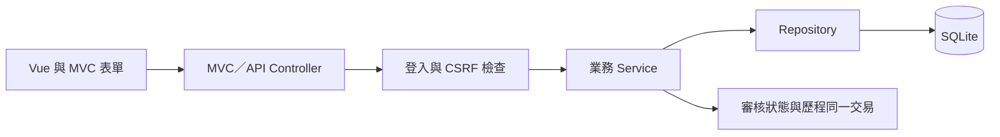

# 實驗室監控系統設計

## Context

動機見 `proposal.md`。已檢查既有 API、AuthService、SQLite 初始化與後台模板：Controller 直接查詢資料庫、監控 API 未檢查登入、審核只更新狀態無歷程、後台統計仍讀取 Booking。`/video` 已有登入／核准驗證與 CSRF，需保留其核心行為。舊歸檔是需求來源，不作為已完成實作的證據。

## Goals / Non-Goals

目標為共用 Service 驗證及一致 API 契約、可追溯資料寫入、非破壞性 SQLite 升級，以及符合工作區規範的離線頁面。角色僅 `user` 與 `admin`；舊探索中的「稽核人員」本輪作為紀錄的執行人員欄位，由管理者操作，不引入第三種登入角色。

不新增通知服務、辨識模型、錄影、多 worker CAM 協調或真正影像串流平台，不刪除舊預約資料。實驗室與攝影機管理僅維護資源及區域對應，新增攝影機資源不代表已接入實體設備。

## Decisions

### 1. 分層與共用驗證

Controller → Service → Repository → SQLite。新增會員審核、監控與稽核 Service／Repository，MVC 與 JSON API 共用業務驗證，領域例外轉為 400／401／403／404／409。避免目前 Controller SQL 與廣泛捕捉例外造成誤判。保留 Blueprint 路由與 `app.py` 入口，不全面改用 ORM，以降低資料升級範圍。

### 2. Session 與密碼變更

受保護路由每次由 Service 取得當前會員角色、核准狀態與 `must_change_password`。登入成功清除先前 Session 後建立新狀態；登出採 POST 並清除 Session。狀態變更使用統一 CSRF Token，Axios 與 MVC 表單共用；既有 video Token 在整合後保持可用。

新增預設管理者時標記強制變更密碼；升級時只對仍符合預設密碼雜湊驗證的系統 admin 標記，不改密碼或核准其他待審核管理者。新密碼至少 8 字元、不得等於預設值；使用 Werkzeug 雜湊。此處不擴大成全體會員密碼政策遷移。

### 3. SQLite migration

沿用 `instance/calendar.sqlite`。以 `schema_migrations` 保存版本，新 migration 在交易內增加 `users.must_change_password`、`member_review_history`、`laboratories`、`cameras`；警示與稽核增加可空的 `laboratory_id`／操作者欄位。保留 `area`／`inspector` 作為舊資料及顯示快照，不以猜測姓名建立會員關聯。

`member_review_history` 保存 `user_id`、`actor_id`、`from_status`、`to_status`、`created_at`；核准／拒絕／停用與歷程 INSERT 共用交易。啟用外鍵，新增索引支援狀態篩選及歷程查詢；先驗證舊外鍵，若有孤兒資料回報而不自動刪除。

資源停用採 `active` 旗標；停用不刪事件。示範資料只於初次初始化建立，清空事件後不可重啟自動補回。資料一致性由 Service 驗證與資料庫約束共同支援，避免單靠前端驗證。

### 4. 路由與狀態

- 身分：`POST /api/v1/auth/register`、`POST /api/v1/auth/login`、`POST /api/v1/auth/logout`、`POST /api/v1/auth/password`。
- 會員：既有 `/admin/users` GET／PATCH，加上 `GET /api/v1/admin/users/{id}/history`。
- 資源：`/api/v1/admin/laboratories`、`/api/v1/admin/cameras` 提供 GET／POST，`/{id}` 提供 PATCH；公開給已核准會員的讀取只回傳啟用資源。
- 警示：既有 monitoring 摘要加上 `PATCH /api/v1/admin/alerts/{id}`；狀態 `open → resolved`。
- 稽核：`POST /api/v1/admin/audits`、`PATCH /api/v1/admin/audits/{id}`；狀態 `open → completed`。

日期使用有效 `YYYY-MM-DD`，時間保存 UTC。回應僅輸出明確允許的欄位，不直接序列化會員資料列。MJPEG 端點維持既有非 JSON 格式。

### 5. 首頁、後台與離線呈現

重用 `static/vendor` 的本機 Vue、Axios、Bootstrap 5.3、SweetAlert2；擴大 Tailwind content 到所有頁面，停用 Preflight。集中 Axios、CSRF 與錯誤處理，使用 Vue `v-text` 避免 XSS／Jinja 衝突。Bootstrap 做 RWD，Tailwind 提供玻璃霧面樣式。

安全率目前沒有定義或辨識模型，因此保留示範數值並明確標示，不發明計算公式。真實待處理警示、稽核及啟用資源數從 SQLite 統計；CAM 可用性只由設備狀態取得，不將資源清單數誤稱連線數。

## Risks / Trade-offs

- 舊 SQLite 外鍵資料不一致 → 升級前執行外鍵檢查，保留資料並回報阻礙。
- 管理者核准自己或停用最後管理者 → Service 在交易內檢查控制者及剩餘已核准管理者。
- 示範資料被誤解成工安保證 → 首頁明確區分示範與實際統計。
- 既有 CAM 依賴單程序及實體硬體 → 保留擷取測試與手動驗證紀錄，不宣稱 Docker 自動取得 Windows CAM。
- 無瀏覽器可驗證 → 相關驗收任務保持未完成，不能以 HTTP GET 或編譯替代。

## Migration Plan

1. 以 SQLite backup API 備份原資料庫，保存 schema 與資料筆數基線。
2. 執行版本 migration，保留舊 `rooms`／`bookings`、會員密碼與事件資料。
3. 驗證重複執行不重複插入，integrity_check 與 foreign_key_check 通過。
4. 部署 API 與前端後驗證完整註冊、審核、登入、停用、稽核及警示流程。
5. 更新 README 與資料結構文件。回滾時停止寫入，還原備份並使用相容版本程式；保留升級後資料庫供比對，不直接刪除新增資料。
